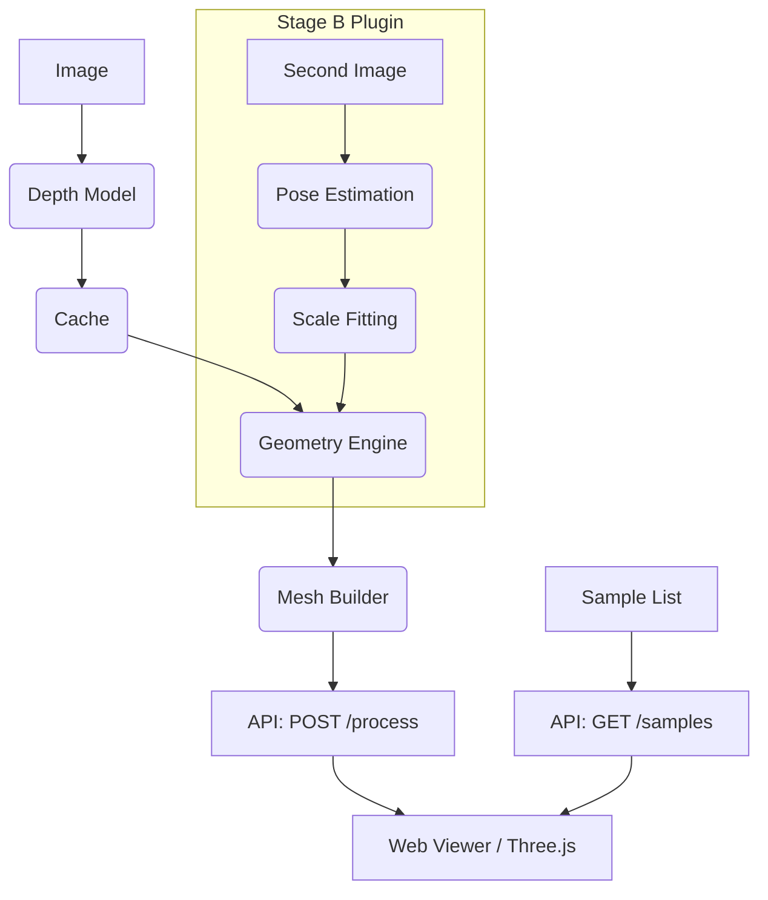

# 02 Architecture

**Pipeline:**
`Image -> Depth -> Geometry -> Mesh -> Viewer`

**Module Responsibilities:**
- `src.depth`: Loading the depth model (once), preprocessing images, caching inferences.
- `src.geometry`: Vectorised math (intrinsics, projection, rotation, homography, inverses). Camera-agnostic.
- `src.mesh`: Unprojecting depth to a 3D grid mesh, cutting triangles across discontinuities, computing UV coordinates.
- `src.server`: FastAPI backend endpoints, caching layer.
- `web/`: HTML/JS/CSS frontend with WebGL (Three.js) viewer.

**FastAPI Endpoints:**
- `POST /process`: Accepts an image, returns mesh data (vertices, indices, UVs) + texture + camera parameters.
- `GET /samples`: Returns a list of available precomputed samples.

**Caching Scheme:**
- Depth maps and intermediate data cached to disk based on the image content hash (SHA-256) and settings.

**Mermaid Diagram:**

**Stage B Extension Points:**
Stage B (two-view geometry) will plug into the pipeline by accepting a second image, estimating the pose between views, fitting the scale, and feeding the updated camera matrices directly into the Geometry Engine.
